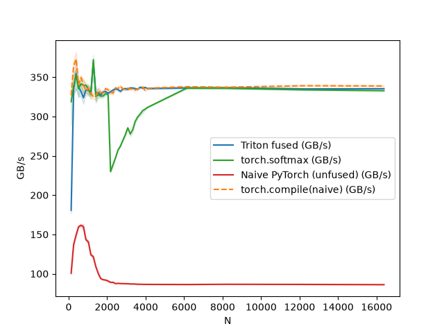
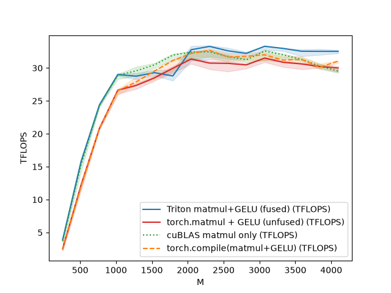
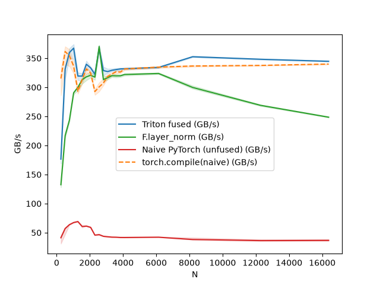
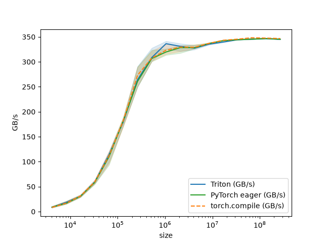

# triton-kernels

**Hand-written GPU kernels in Triton, measured head-to-head against PyTorch, cuBLAS and `torch.compile` on a laptop RTX 5060.**

Four kernels, from "hello world" to a tensor-core matmul, each with correctness tests, a benchmark sweep, and comments that explain every line. Everything runs natively on Windows on a Blackwell (sm_120) GPU.

---

## TL;DR

| | Result |
|---|---|
| Fused softmax vs. naive PyTorch | **3.9x faster** (336 vs 86 GB/s) |
| Why it is faster | **1 kernel instead of 5, 4x less memory traffic** (134 MB vs 537 MB) |
| Matmul + GELU, fused vs. unfused | **1.3x faster at 512**, 1.08x at 4096 |
| Fused LayerNorm vs. `F.layer_norm` (16384 cols) | **345 vs 249 GB/s** |
| Correctness | **74 / 74 tests passing** against PyTorch |

Every number here comes from a real run on this machine and lives in [`results/`](results/).

---

## What's inside

| Kernel | What it shows | File |
|---|---|---|
| **Vector add** | The basics: program IDs, block offsets, masking the ragged tail | [`kernels/vector_add.py`](kernels/vector_add.py) |
| **Fused softmax** | Kernel fusion: one read and one write per row, numerically stable, plus an online-softmax path for very long rows | [`kernels/softmax.py`](kernels/softmax.py) |
| **Matmul + GELU** | Block tiling, grouped ordering for L2 reuse, autotuning, fp16 tensor cores with fp32 accumulation, activation fused into the epilogue | [`kernels/matmul.py`](kernels/matmul.py) |
| **Fused LayerNorm** | Mean and variance computed in registers in a single pass over memory | [`kernels/layernorm.py`](kernels/layernorm.py) |

For each kernel, [`WALKTHROUGH.md`](WALKTHROUGH.md) covers the idea, the code path and the numbers, with common questions and answers.

---

## The core idea: memory traffic is the bottleneck

Most of these operations do very little math per byte, so speed is set by how many bytes cross the memory bus. Naive PyTorch softmax runs five separate kernels, and each one reads a full matrix from GPU memory and writes one back:

```
naive:  x -> [max] -> [x - max] -> [exp] -> [sum] -> [divide] -> out     5 kernels, 537 MB
fused:  x -> [load row once, do everything in registers, store once] -> out     1 kernel, 134 MB
```

Measured on a 4096 x 4096 fp32 matrix:

| | Kernels | Memory moved | GPU time |
|---|---|---|---|
| Naive PyTorch | 5 | 536.9 MB | 1550 us |
| **Triton fused** | **1** | **134.2 MB** | **408 us** |
| Ratio | 5x | 4.00x | 3.80x |

The speedup (3.80x) tracks the traffic reduction (4.00x) almost exactly, which is what you expect from a memory-bound operation.

*How this was measured:* `torch.profiler` cannot see the GPU on this machine (CUPTI fails with `CUPTI_ERROR_INVALID_DEVICE`), so each version was captured into a CUDA graph and its kernel nodes were counted. Bytes are computed from tensor shapes, and times come from `triton.testing.do_bench`. Script: [`bench/profile_softmax.py`](bench/profile_softmax.py).

---

## Results

All timings are medians from `triton.testing.do_bench`, with the L2 cache flushed between runs.

### Fused softmax (fp32, 4096 rows)



| Columns | **Triton fused** | torch.softmax | Naive PyTorch | torch.compile |
|---|---|---|---|---|
| 1024 | **333 GB/s** | 335 | 140 | 336 |
| 4096 | **336 GB/s** | 312 | 86 | 336 |
| 16384 | **335 GB/s** | 333 | 86 | 339 |

The hand-written kernel matches PyTorch's built-in softmax and the `torch.compile` output, and is about 4x faster than the unfused version.

### Matmul + GELU (fp16 in, fp32 accumulate, square matrices)



| Size | **Triton fused** | matmul + GELU (unfused) | cuBLAS matmul only | torch.compile |
|---|---|---|---|---|
| 512 | **15.8 TFLOPS** | 12.2 | 15.3 | 12.1 |
| 2048 | **32.8 TFLOPS** | 31.4 | 32.4 | 32.2 |
| 4096 | **32.5 TFLOPS** | 30.0 | 29.5 | 31.0 |

The Triton kernel is roughly level with cuBLAS on this GPU and beats the unfused PyTorch version at every size. `torch.compile` does *not* fuse GELU into the matmul here: its generated code is a cuBLAS call followed by a separate GELU kernel.

### Fused LayerNorm (fp16, 4096 rows)



| Columns | **Triton fused** | F.layer_norm | Naive PyTorch | torch.compile |
|---|---|---|---|---|
| 256 | 176 GB/s | 132 | 41 | 315 |
| 4096 | **332 GB/s** | 322 | 42 | 332 |
| 16384 | **345 GB/s** | 249 | 37 | 340 |

### Vector add (fp32)



All three implementations reach the same ceiling, about **345 GB/s**, the practical memory bandwidth of this GPU (2^28 elements: Triton 345, eager 345, compile 347 GB/s). That ceiling is the reference point for the other memory-bound kernels.

---

## Lessons learned

- **Fusion beats cleverness for memory-bound ops.** Removing intermediate tensors gave the biggest wins.
- **Fusion helps matmul most at small sizes.** A large matmul is limited by compute, so saving one pass over the output matters less as N grows.
- **`torch.compile` is a strong baseline.** It matched the hand-written softmax and LayerNorm. Writing kernels by hand pays off where the compiler does not fuse, as with the matmul epilogue here.
- **Short rows are my kernels' weak spot.** With one row per program, a 128-column softmax leaves most threads idle: 181 GB/s against 319 for `torch.softmax`. Packing several rows into each program is the next improvement.
- **Laptop GPUs are noisy to benchmark.** The power cap moves clocks between 1357 and 2767 MHz, so differences of a few percent at large sizes are noise. For example, cuBLAS-only reads 29.5 TFLOPS at 4096 in the sweep but 33-34 TFLOPS measured on its own.

---

## Quickstart

```
uv venv --python 3.12
uv pip install torch --index-url https://download.pytorch.org/whl/cu128
uv pip install "triton-windows>=3.6,<3.7" numpy pytest matplotlib pandas   # Linux: triton
.venv\Scripts\activate

pytest                     # 74 correctness tests
python bench/run_all.py    # regenerates every CSV, plot and profile in results/
```

On Windows, `triton-windows` bundles its own CUDA toolchain and compiler. Only the Visual C++ 2015-2022 redistributable is required.

## Project layout

```
kernels/          the four Triton kernels (commented line by line)
tests/            pytest correctness tests vs PyTorch
bench/            benchmark sweeps, softmax profiling, run_all.py
results/          CSVs, plots, profile output, environment.txt
WALKTHROUGH.md    deep dive per kernel
```

## Environment

| | |
|---|---|
| GPU | NVIDIA GeForce RTX 5060 Laptop GPU (Blackwell, sm_120, 26 SMs, 8 GB, 32 MB L2) |
| Driver | 610.91 (CUDA 13.3) |
| PyTorch | 2.11.0+cu128 |
| Triton | 3.6.0 (`triton-windows` 3.6.0.post26) |
| Python | 3.12.14 |
| OS | Windows 11, native (no WSL), on AC power |

## Notes

